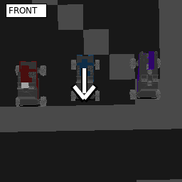

# Virtual-camera HoloView proof

Status: **verified, bounded grid-only HoloView rendering in disposable Space Engineers worlds**. VRageCage can stage one to four explicit 256×256 world-space poses, run one read-only HoloView worker job per pose, and export RGBA plus pose/tick metadata without a physical camera or LCD pair. A single pose is a spectator view: choose any world-space origin and camera orientation, then render nearby saved-grid geometry from that viewpoint. A separate on-demand bridge exposes `capture_view` through Voidwright, but VRageCage's static pose request does not depend on Voidwright or its perspective IDs. Neither path needs an LCD entity or retained LCD-output buffer. Both use HoloView's software rasterizer, not a native game screenshot. Planet terrain is rejected by default; an explicit grid-only option permits planet-world captures and records that terrain is absent.

## Build and runtime dependencies

No required game assembly or runtime component was missing on mpai for this test. The disposable worker has Space Engineers Dedicated Server `01_210_014` with `Sandbox.Common.dll`, `Sandbox.Game.dll`, `Sandbox.Graphics.dll`, `SpaceEngineers.Game.dll`, `VRage.dll`, `VRage.Game.dll`, `VRage.Math.dll`, `VRage.Library.dll`, `VRage.Scripting.dll`, `VRage.Mod.Io.dll`, and the other dedicated-server assemblies under `server/DedicatedServer64/`. Magnetar `2.4.2.4` supplies the mod loader and game-script compiler; its local .NET SDK is `10.0.401`. HoloView's `Data/Scripts/HoloView3D/*.cs` is present in the disposable local-mod copy, including `HoloCamWaterModAPI.cs`, which supplies the `Jakaria.API` namespace used by the worker. No separate downloaded SDK or licensed graphical client was required.

The game runtime is the meaningful build check. An initial compile rejected `System.Security.Cryptography.SHA256` under the mod-script `ProhibitedMemberRule`; the mod now writes bounded base64 RGBA and the external verifier computes SHA-256. On the final run the replacement HoloView module registered and both virtual jobs completed. These are HoloView software renders, **not** native screenshots.

## Extraction implemented

`worker/instrument-holoview-virtual.py` validates a stopped imported destructive-lab copy and a strict one-to-four-pose request, then stages a unique local mod copy. Supply one pose for a spectator view or several poses for a bounded viewpoint comparison. It adds a virtual job branch to `PortalLcdSession.UpdateAfterSimulation`, overloads stable raster candidate selection to accept a separate dictionary of source-grid proxies, and routes completed virtual jobs to an exporter before LCD presentation. Physical jobs retain their original proxies, camera resolution, scheduling, and text-surface presentation path.

Example one-view request (`poses` is the only view-specific input):

```json
{
  "world_name": "test_suite_world_v2_r3",
  "request_id": "spectator_request_001",
  "capture_id": "spectator_view_001",
  "width": 256,
  "height": 256,
  "range_m": 200,
  "allow_terrain_omission": true,
  "poses": [
    {
      "origin": [12.2, 108.7, 22.1],
      "forward": [0, 0, -1],
      "up": [0, 1, 0],
      "fov_degrees": 60
    }
  ]
}
```

The origin and basis are in Space Engineers world coordinates. `forward` and `up` must be unit and perpendicular; choose them to aim the virtual viewpoint. `allow_terrain_omission` is optional and defaults to false. Set it true only when grid-only imagery is useful in a planet world; the frame receipt explicitly says `terrain_included: false`. Stage it with `worker/instrument-holoview-virtual.py INSTANCE SOURCE_MOD REQUEST.json --stage-name STAGE_NAME`, then use the existing guarded disposable-world registration and run workflow. The staged run exports `vragecage-virtual-CAPTURE_ID-0.rgba64.txt` and a JSON pose/tick receipt to the HoloView world storage. This is currently a bounded staged capture, not a live interactive camera feed or native screenshot.

For a virtual job, grids are acquired directly from `MyAPIGateway.Entities`, bounded to 64 nearby grids within the requested range, then cached and frustum-filtered against the requested matrix. That scene is snapshotted into `WorkerRasterJob`; its `Cam` and FOV drive HoloView's existing software rasterizer. No camera or LCD entity ID is supplied. Shared main-thread frustum settings are restored after each snapshot. A planet is rejected by default because this proof does not build a view-local terrain lattice. The explicit terrain-omission option allows grid rendering in a planet world but does not show ground or terrain; frame metadata records this omission.

The request fields are `origin`/`forward`/`up` in Space Engineers world coordinates (meters; orthonormal camera basis), horizontal `fov_degrees`, world session name, request/capture IDs, range, and 256×256 dimensions. Non-finite or non-unit vectors, non-perpendicular axes, out-of-range FOV/origin/range, unexpected fields, and mismatched world name are rejected. This is a lab instrumenter, not a network listener.

## On-demand image path

For an existing enrolled grid and process-local perspective, use Voidwright MCP `capture_view`.
The adapter writes a bounded request to the configured HoloView world-storage mailbox, HoloView
renders the requested virtual pose, and the adapter returns a PNG with run/snapshot/render provenance.
The path needs no physical camera block, LCD entity, or LCD output buffer. It is a one-request-at-a-time
software render, not a continuous video feed; it renders bounded saved-grid geometry and rejects
planet terrain. The adapter and runtime setup are documented in
[`voidwright-live-capture-2026-10-13.md`](voidwright-live-capture-2026-10-13.md).

The periodic physical-camera capture described in `render-trials.md` is a separate path: it samples
HoloView's completed retained LCD RGBA output for a specific camera/output pair. Use that when the
LCD composition itself is the subject. Use virtual `capture_view` for viewpoint imagery without an
LCD target.

## Two-pose test receipt

Fixture: `test_suite_world_v2_r3`, imported as `virtual-holoview-v2r3-liveprobe-20261012`; original source save untouched. Request fixture: `worker/tests/fixtures/virtual-v2r3-two-pose.json`, capture `v2r3_two_pose_003`. Both jobs used origin `(12.231835870180294, 108.66975564371641, 22.139290751900624)` and FOV `39.804°`; the second heading was rotated approximately 25°.

The final clean lab run ID was `b2ce228e93c881479b809117e05b513f`. Its terminal receipt SHA-256 was `9db434fd8d67e39e2e8b634a848e008330589566457dcc719d3deebc3f8a504c`. In-mod frame markers occur in that receipt's hashed game log. `worker/verify-holoview-virtual.py` checks the hashed log, clean terminal state, exact mod/storage identity, world/request/pose/FOV/tick/dimensions, nonblank frames, and pixel hashes. It binds the **actual** run ID externally, because the lab launcher generates it at activation; the mod does not pretend its request ID is a verified run ID.

| Pose | Tick | Geometry primitives | RGBA SHA-256 |
| --- | ---: | ---: | --- |
| 0 | 61 | 1,153 | `d3b7d7e2aa2d99ea91dab0fb3ecbaf503ab66f5bc33b8207fa3f581d82f17e9e` |
| 1 | 71 | 2,355 | `160b95f239e9e1999b2852732191009fe34e649bdaa8150cfd3762d99c2f8253` |

The images differ at 41,932 pixels. Visual inspection shows the platform features shift with the two headings; this is not merely a hash change. The instance was stopped cleanly. Raw frames and receipts remain in the disposable instance's `Saves/test_suite_world_v2_r3/Storage/90072030983701718.sbm_HoloView3D/`; its terminal receipt is `Quarantine/b2ce228e93c881479b809117e05b513f/terminal-receipt.json`.

To reproduce on a **new** stopped disposable world copy: stage HoloView source with `worker/instrument-holoview-virtual.py`, register that staged mod, replace only the copied world's published HoloView entry with `worker/replace-published-mod.py`, run and stop the isolated Magnetar instance, then invoke `worker/verify-holoview-virtual.py FRAME_STORAGE REQUEST_JSON TERMINAL_RECEIPT`. Never point the instrumenter at a production world or Workshop cache.

## Follow-up: terrain rendering

The V4 test used the explicit grid-only planet option. Add terrain support as a separate follow-up: extract a bounded view-local terrain surface, feed it into the software rasterizer with suitable detail/occlusion handling, then verify terrain-inclusive captures in a disposable planet fixture. Keep terrain omission explicit until that path is implemented and verified.

## Remaining limits

This establishes arbitrary-angle **grid** rendering, not all possible world geometry or a general scene API. VRageCage's current request is one to four static poses embedded into a staged local mod; it does not accept live interactive viewpoint changes. Planet captures require the explicit `allow_terrain_omission` opt-in and render no ground or terrain. Dynamic entities and environmental effects are not yet independently selected for the virtual scene. Multi-pose frames are rendered at separate updates, not simultaneously. A future live spectator service could reuse a typed `RenderView` for grid, terrain, dynamic-entity selection, and rasterization.
The virtual branch neither resolves nor supplies physical camera/LCD IDs; captures are exported directly from the software rasterizer.

## V4 truck front-marker test

The camera-free software spectator path was exercised against the disposable V4 fixture `test-suite-world-v4-obstacle-baseline-20261018-e`, targeting Blue Truck grid `105034224363529183`. Request fixture: `worker/tests/fixtures/virtual-v4-blue-truck-spectator.json`. The camera pose was above the truck. The initial annotation direction was reversed; the preview below corrects the arrow to point toward the truck's front. The planet's terrain was intentionally omitted and the frame receipt records `terrain_included: false`.

The verified frame contains 445 geometry primitives and 65,399 visible pixels at 256×256. Its raw RGBA SHA-256 is `403fa6c6a395ef8a13fa9c2ee562a9ee500d39c99c73f5d6e76a95f8c1e73b0a`. Run `50593dd206795956859f2cb394fa5437` completed and the server stopped cleanly. The rendered view and pose/verification receipts are in `artifacts/spectator-view-v4-blue-truck-20261022/`.

The white arrow and `FRONT` label in the preview below are a corrected, post-capture overlay. They are a visualization aid, not an in-game marker, object, or measurement emitted by HoloView. The unannotated software-rendered frame is kept alongside the PNG overlay in `docs/assets/`.


